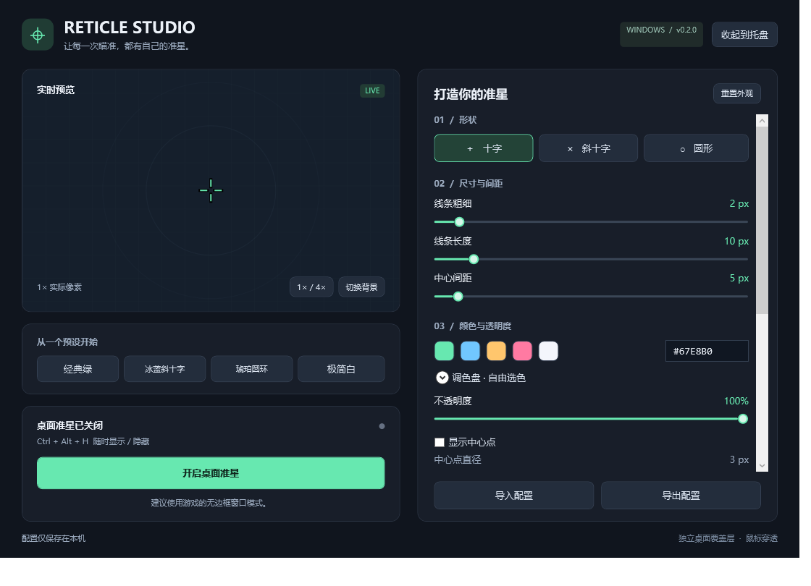

# Reticle Studio · CS 准星工具

为 Windows 上的 CS 等 FPS 游戏制作自己的准星。原生 C# / WPF 桌面程序，中文界面，使用独立透明覆盖窗口。



## 运行

本地项目中双击 **`Start-Reticle.cmd`**。便携版位于 `artifacts/Reticle-win-x64/Reticle.exe`，压缩包位于 `artifacts/Reticle-v0.1.0-win-x64.zip`。

远程下载：[GitHub Releases](https://github.com/yangr8640-eng/reticle-studio/releases)。仓库为私有，需要已授权的 GitHub 账号才能访问。

便携版自带 .NET 运行时，解压后双击包内的 **`Reticle.exe`**，无需管理员权限。首次启动准星处于关闭状态，点击“开启桌面准星”即可显示；点击“收起到托盘”可隐藏设置窗口。关闭设置窗口的 × 会退出程序并关闭准星。

推荐在游戏中选择**无边框窗口**或窗口化模式。独占全屏、受保护的渲染表面及其他置顶窗口可能遮挡桌面覆盖层；尚未完成实际游戏兼容性验证。请按所玩游戏与赛事的规则使用，不保证任何反作弊系统允许外部覆盖层。

## 功能

- 十字、斜十字（45°）、圆形准星。
- 线宽、线长、中心间距、圆半径、HEX 颜色、不透明度。
- 可选中心点、点大小、黑色描边及描边宽度。
- 4 个外观预设、1× / 4× 预览、3 种预览背景。
- 透明置顶覆盖层，鼠标穿透，不抢占键盘焦点。
- 显示器选择、水平 / 垂直偏移、重新居中。
- 自动保存、JSON 导入导出、损坏配置备份。
- 托盘菜单、全局快捷键、重复启动保护。

| 操作 | 快捷键 |
| --- | --- |
| 显示 / 隐藏准星 | `Ctrl + Alt + H` |
| 打开设置 | `Ctrl + Alt + S` |

快捷键被其他程序占用时，设置界面会显示提示；仍可使用按钮与托盘。

尺寸使用**物理像素**。中心间距是从中心到每条线内端的径向距离，斜十字旋转后保持这一距离；圆形通过半径控制中心留白。描边会向线条两侧各扩展指定宽度。4× 预览不改变实际覆盖层大小。选中滑块后，可用方向键精细调整。

配置保存在 `%LOCALAPPDATA%/ReticleStudio/settings.json`。程序本身不访问网络，不读取、修改或注入游戏进程。

## 开发与验证

需要 Windows x64 和 .NET 10 SDK。

```powershell
./scripts/build.ps1
./scripts/build.ps1 -Portable
```

也可以直接使用标准 .NET CLI：

```powershell
dotnet build src/Reticle.App -c Release
dotnet run --project tests/Reticle.Tests -c Release
dotnet run --project src/Reticle.App -c Release
```

桌面诊断（会短暂创建测试窗口，独立保存测试配置）：

```powershell
./scripts/test-desktop.ps1
```

诊断结果与 WPF 界面渲染图片位于 `artifacts/diagnostics/`。它检查覆盖层窗口标志、焦点、居中和偏移、显示隐藏、真实绘制像素、控件事件和配置持久化；不能代替真实游戏、混合 DPI 多屏以及实际鼠标 / 键盘输入测试。

## 目录

```text
src/Reticle.Core/   参数约束、准星几何、配置存储
src/Reticle.App/    WPF 编辑器、覆盖层、Win32 接口与桌面诊断
tests/             不依赖第三方测试包的核心逻辑检查
scripts/           构建、打包与桌面诊断
docs/              界面预览及验证记录
project.md         项目范围、版本计划、进展与待办
```

`.github/workflows/build.yml` 在推送后执行 Windows 构建、核心检查并上传便携包；v0.1.0 已在线通过。当前 GitHub 同步状态详见 `project.md`。

## 实现参考

- [Microsoft：Layered Windows 与鼠标穿透](https://learn.microsoft.com/en-us/windows/win32/winmsg/window-features)
- [Microsoft：WPF 透明窗口](https://learn.microsoft.com/en-us/dotnet/api/system.windows.window.allowstransparency)
- [Microsoft：窗口激活与 ShowActivated](https://learn.microsoft.com/en-us/dotnet/desktop/wpf/windows/)
