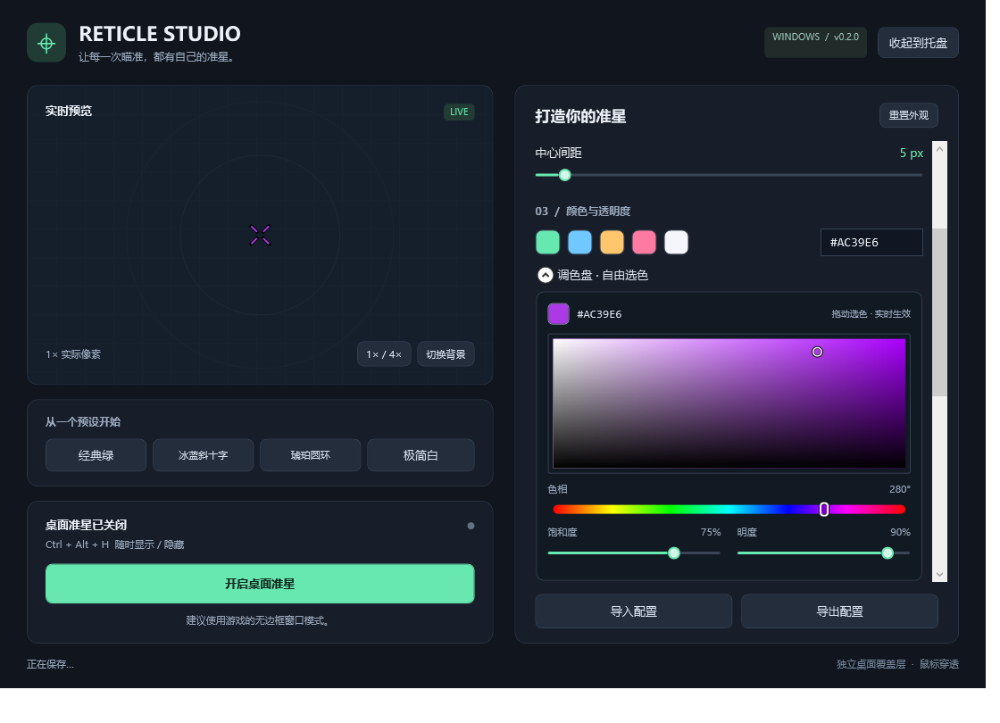

# Reticle Studio · CS 准星工具

为 Windows 上的 CS 等 FPS 游戏制作自己的准星。中文编辑器提供桌面覆盖层和可选的 Xbox Game Bar 组件两种显示方式。


## 运行

**使用 v0.3.0-preview.2 的 Game Bar 模式时，CS 可以保留“全屏”，不要求改成“全屏窗口化”。** 需要安装并固定 Game Bar 准星组件、启用鼠标穿透。下载 [全屏预览版](https://github.com/yangr8640-eng/reticle-studio/releases/tag/v0.3.0-preview.2)，或查看 [完整安装指南](docs/fullscreen-gamebar.md)。v0.2.1 仍为稳定桌面版。

| 工具版本 / 显示方式 | CS 显示模式 | 验证范围与限制 |
| --- | --- | --- |
| v0.2.1，或预览版中的“桌面 · 无边框” | 全屏窗口化 / 无边框 / 窗口化 | 普通桌面覆盖层，不支持真正独占全屏 |
| v0.3.0-preview.2 的“全屏 · Game Bar（实验）” | 可保留“全屏” | 本机组件显示已确认；CS 游戏内全屏尚待实测，依赖 Windows / Game Bar 的覆盖支持 |

**CS 菜单中的“全屏”与底层是否采用真正独占呈现是两件事。** 当前预览版没有保证“禁用全屏优化 + 真正独占全屏”仍可显示准星；若用户为降低延迟坚持这种设置，需要在其机器单独验证，不能把桌面显示成功当作兼容性保证。

本地项目中双击 **`Start-Reticle.cmd`**。便携编辑器位于 `artifacts/Reticle-win-x64/Reticle.exe`，当前源码打包为 `artifacts/Reticle-v0.3.0-preview.3-win-x64.zip`。本次编辑器升级继续配合 preview.2 的全屏组件使用，组件需单独安装。

远程下载：[GitHub Releases](https://github.com/yangr8640-eng/reticle-studio/releases)。仓库已公开，无需登录即可查看源码与下载发行包。

便携编辑器自带 .NET 运行时，解压后双击包内的 **`Reticle.exe`**，运行编辑器无需管理员权限。首次启动准星处于关闭状态，先选择显示方式，再点击对应的开启按钮；点击“收起到托盘”可隐藏设置窗口，**左键单击托盘图标即可重新打开**，也支持双击。右键显示菜单。关闭设置窗口的 × 会退出程序并关闭同步准星。Game Bar 组件首次安装另需信任测试证书，详见安装指南。

选择**桌面模式**时，游戏需使用全屏窗口化 / 无边框或窗口化。桌面准星每 500 ms 恢复置顶和位置，恢复时不抢焦点；普通桌面模式仍不支持独占全屏。选择**全屏 · Game Bar（实验）**时，使用单独安装的 Game Bar 组件，并由 Windows 的游戏覆盖支持决定兼容性。尚未完成实际 CS 游戏内兼容性验证。请按所玩游戏与赛事的规则使用，不保证任何反作弊系统允许外部覆盖层。

### 保留 CS“全屏”：使用 Game Bar 模式

1. 安装 preview.2 的编辑器和独立 Game Bar 组件，从托盘退出旧版编辑器。
2. CS 视频设置保持 **全屏**。在游戏中按 Win+G，确认 Game Bar 能覆盖游戏画面。
3. 在 Game Bar 的小组件菜单打开 **Reticle Studio 准星**，点击图钉固定并开启鼠标穿透。
4. 编辑器选择 **全屏 · Game Bar（实验）**，点击 **开启全屏组件**；收起 Game Bar 后测试准星。

如果 Game Bar 只会切出游戏、黑屏或无法覆盖，请按 [全屏模式排障](docs/fullscreen-gamebar.md) 检查 Windows 全屏优化与宿主状态；此时不能直接承诺这台机器支持该模式。

### 使用桌面模式：全屏窗口化 / 无边框

以下步骤**仅适用于 v0.2.1 或预览版的桌面模式**，不是 Game Bar 模式的要求。

1. 启动编辑器；预览版选择 **桌面 · 无边框**。
2. 在 CS 视频设置中选择 **全屏窗口化 / 无边框** 或窗口化，并应用。
3. 在本工具中选择游戏所在的显示器，点击“开启桌面准星”，再切回游戏。切换窗口后，准星通常在 0.5 秒左右恢复。
4. 若仍不可见，检查不透明度、位置偏移及 `Ctrl + Alt + H` 显示开关；不要继续使用“独占全屏”测试桌面覆盖层。

## 功能

- 十字、斜十字（45°）、圆形准星。
- 线宽、线长、中心间距、圆半径、HEX 颜色、不透明度。
- 可视化调色盘：彩虹色相条、可拖动的饱和度 / 明度面板、精细调整滑块，与 HEX 和预设双向同步。
- 可选中心点、点大小、黑色描边及描边宽度。
- 4 个外观预设、1× / 4× 预览、3 种预览背景。
- 透明置顶覆盖层，鼠标穿透，不抢占键盘焦点；自动恢复置顶和物理像素位置。
- 显示器选择、水平 / 垂直偏移、重新居中。
- 自动保存、JSON 导入导出、损坏配置备份。
- 托盘单击打开、右键菜单、全局快捷键、重复启动保护。
- 手动检查更新：主界面右上角或托盘菜单点击“检查更新”，支持预览版筛选、失败重试及打开发布页下载。

| 操作 | 快捷键 |
| --- | --- |
| 显示 / 隐藏准星 | `Ctrl + Alt + H` |
| 打开设置 | `Ctrl + Alt + S` |

快捷键被其他程序占用时，设置界面会显示提示；仍可使用按钮与托盘。

尺寸使用**物理像素**。中心间距是从中心到每条线内端的径向距离，斜十字旋转后保持这一距离；圆形通过半径控制中心留白。描边会向线条两侧各扩展指定宽度。4× 预览不改变实际覆盖层大小。选中滑块后，可用方向键精细调整。

配置保存在 `%LOCALAPPDATA%/ReticleStudio/settings.json`。仅在打开“检查更新”、切换预览版筛选或点击“重新检查”时连接 GitHub 获取公开版本列表，不上传准星配置；点击下载按钮会使用默认浏览器打开项目发布页。程序不读取、修改或注入游戏进程。

### 检查更新

点击右上角或托盘右键菜单中的 **检查更新**。预览版默认勾选“包含预览版”，正式版默认只检查正式版；可在窗口中切换。仅提示版本号比当前更高的版本，`preview.10` 会正确排在 `preview.2` 之后，同版本正式版高于预览版。无网络、超时或服务限流会显示失败提示，可重试或手动打开发布页。

发现新版后点击 **前往下载**，在 GitHub 发布页下载便携包。退出旧版后解压运行新版，外观配置会从原路径读取。检查更新不会自动安装或替换正在运行的程序；Game Bar 组件若有新版，按发布页说明单独安装。

## 使用调色盘

在“颜色与透明度”下展开 **“调色盘 · 自由选色”**。拖动彩虹条选择色相，再在上方颜色区域点击或拖动：左右改变饱和度，上下改变明度。下方滑块可进一步微调；黑色、白色和灰色也可直接选取。



选色即时更新准星、HEX 和自动保存。也可以继续使用快捷色块或直接输入 `#RRGGBB`。点击颜色区域后，方向键每次微调 1%，按住 Shift 为 10%。原有配置无需转换。

## 开发与验证

需要 Windows x64 和 .NET 10 SDK。

```powershell
./scripts/build.ps1
./scripts/build.ps1 -Portable
```

也可以直接使用标准 .NET CLI：

```powershell
dotnet build src/Reticle.App -c Release
dotnet run --project tests/Reticle.Tests -c Release
dotnet run --project src/Reticle.App -c Release
```

桌面诊断（会短暂创建测试窗口，独立保存测试配置）：

```powershell
./scripts/test-desktop.ps1
```

诊断结果与 WPF 界面渲染图片位于 `artifacts/diagnostics/`。它检查覆盖层窗口标志、焦点、居中和偏移、显示隐藏、真实绘制像素、控件事件和配置持久化，并创建无边框置顶窗口验证遮挡恢复；不能代替真实游戏、混合 DPI 多屏以及实际鼠标 / 键盘输入测试。

## 目录

```text
src/Reticle.Core/   参数约束、准星几何、配置存储
src/Reticle.App/    WPF 编辑器、覆盖层、Win32 接口与桌面诊断
src/Reticle.GameBar/ 独立 UWP Game Bar 准星组件
tests/             核心逻辑、真实组件解析、透明度与几何检查
scripts/           构建、打包与桌面诊断
docs/              界面预览及验证记录
project.md         项目范围、版本计划、进展与待办
```

`.github/workflows/build.yml` 在推送后执行 Windows 构建、核心检查并上传便携包；[v0.2.1 已在线通过](https://github.com/yangr8640-eng/reticle-studio/actions/runs/40298483128)。当前 GitHub 同步状态详见 `project.md`。

## 实现参考

- [Microsoft：Layered Windows 与鼠标穿透](https://learn.microsoft.com/en-us/windows/win32/winmsg/window-features)
- [Microsoft：WPF 透明窗口](https://learn.microsoft.com/en-us/dotnet/api/system.windows.window.allowstransparency)
- [Microsoft：窗口激活与 ShowActivated](https://learn.microsoft.com/en-us/dotnet/desktop/wpf/windows/)
- [Microsoft：SetWindowPos 置顶与不激活标志](https://learn.microsoft.com/en-us/windows/win32/api/winuser/nf-winuser-setwindowpos)
- [Microsoft：DXGI 显示模式与桌面合成](https://learn.microsoft.com/en-us/windows/win32/direct3ddxgi/for-best-performance--use-dxgi-flip-model)
